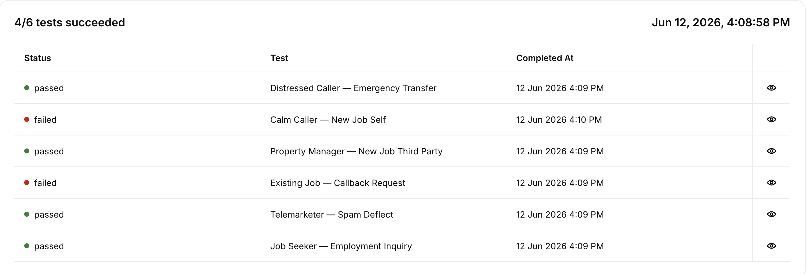

A few months ago, I was approached by a ServPro franchisee to help build a new automated front desk agent to help them rapidly respond to callers and make them feel heard.
Together with their team, I built a robust AI phone assistant that triaged incoming calls, escalated emergencies to on-call staff, and cut down on spam incidents for around $0.07/minute.

## Why not an IVR tree

This ServPro franchisee was particular about their customers being able to access help quickly.  Often, someone is calling in distress because they just came home to a fire or water
emergency and need a rapid response.  Asking them to navigate an IVR tree while under duress would lead to misrouted calls and general customer frustration.  I determined that a
clearly announced AI agent receptionist would better serve their users while more quickly routing them to the human they actually need to talk to.

## What I built

ServPro came to me with a script; I turned that into a workflow.  While AI agents are naturally suited to following a customer service script, the instructions need to be reframed
to better influence the model's decision making while on the phone call.  I turned the workflow into a deterministic state machine where after classifying the user's intent, the agent
was able to respond with the right set of tools and the right guidance appropriate for that conversation.

## Design decisions

ServPro asked me to record new service requests as records in their database rather than escalating them to humans.  To accomplish this I gave the agent a tool that sent an HTTP POST request to a Ruby on Rails glueware application that I built.
This POST request contains the agent's understanding of the intake record.  After the call ends, I ran a second agent over the transcript to verify the agent's understanding and correct anything the agent may have misheard.  This two-pass approach
resulted in significantly greater accuracy.

We added LLM-enforced guardrails, including instructions to prevent the agent from promising that the information was recorded unless the HTTP POST was successful.  Rigorous adversarial testing ensured that the agent stuck to the guardrails and
properly followed the workflow.

## What ServPro owns

Servpro now owns their complete front desk voice agent at a cost of just $0.07/minute.  They can make tweaks and re-run tests at any time to adapt the agent to new circumstances.  I also handed off the Ruby on Rails glueware app to their internal
development team, who is hosting it within their cloud. 

A complete solution, full ownership, and successful deployment.  This is what I deliver as your fractional FDE.